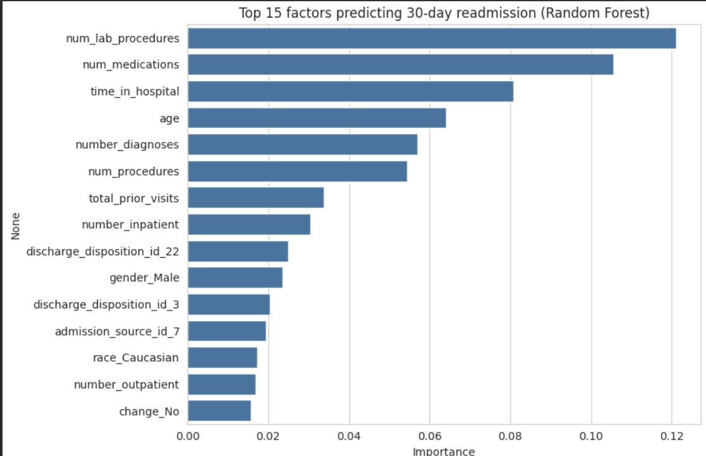
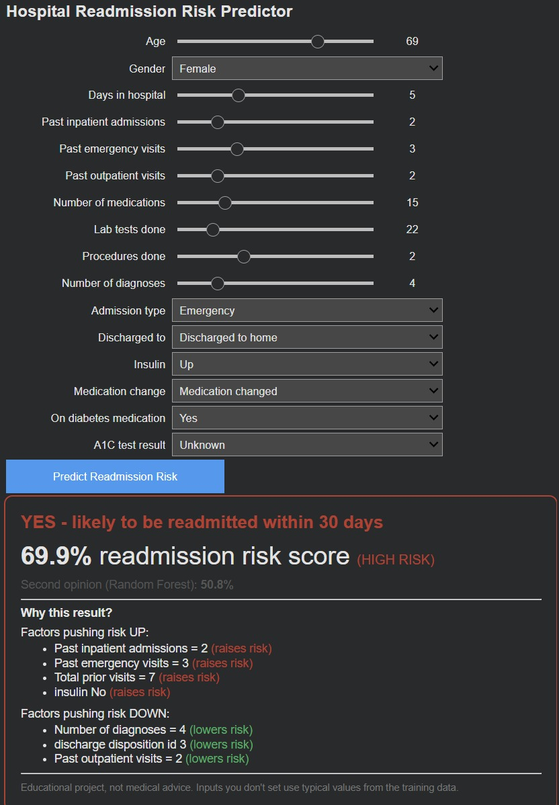
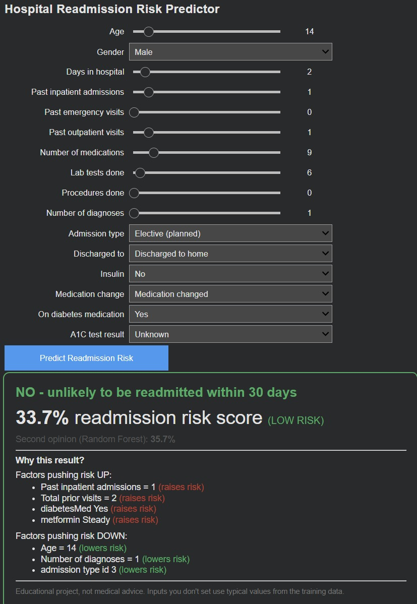

# Hospital Readmission Risk Prediction

Predicts whether a diabetic patient will be readmitted to hospital within 30 days of discharge, and explains why. Built with Python, SQL and Scikit-learn, and finished with an interactive risk predictor.

## Why this problem matters

When a patient returns within 30 days of discharge, it often points to a gap in care, and it is costly for hospitals. A model that ranks patients by readmission risk lets a hospital focus limited follow-up resources (calls, early check-ups, medication counselling) on the patients who need them most.

**Task:** binary classification. `1` = readmitted within 30 days, `0` = not.

## Dataset

[Diabetes 130-US Hospitals (1999-2008)](https://archive.ics.uci.edu/dataset/296/diabetes+130-us+hospitals+for+years+1999-2008), UCI Machine Learning Repository: 101,766 hospital encounters, 50 columns (demographics, hospital stay details, lab tests, medications, prior visits).

## Approach

1. **SQL exploration:** loaded the data into SQLite and queried readmission rates by age group and by number of prior inpatient visits.
2. **Data cleaning:**
   - Converted `?` placeholders to missing values
   - Dropped columns with heavy missingness (`weight`, `payer_code`, `medical_specialty`)
   - Removed patients who died or went to hospice (they cannot be readmitted)
   - Kept one encounter per patient to avoid the same patient appearing in both train and test (data leakage)
   - Dropped ID columns and raw diagnosis codes (too many categories for this version)
3. **Feature engineering:** converted age ranges to midpoints, treated admission/discharge IDs as categories, created `total_prior_visits`, one-hot encoded categorical columns (112 features in total).
4. **Train/test split:** 80/20, stratified (55,989 train / 13,998 test).
5. **Modeling:** Logistic Regression (with feature scaling) and Random Forest, both with class weights to handle imbalance.
6. **Evaluation:** ROC-AUC, precision, recall, F1, confusion matrices and ROC curves.
7. **Interpretation:** Random Forest feature importance, and per-patient reasons from Logistic Regression coefficients.
8. **Interactive predictor:** a form where you enter patient details and get Yes/No, a risk percentage, a risk level and the factors behind it.

## Key findings

- **Class imbalance:** after cleaning, only **8.98%** of patients were readmitted within 30 days, so accuracy alone is misleading. ROC-AUC and recall were used instead.
- **Prior inpatient visits show the strongest relationship.** In the SQL analysis of all 101,766 raw encounters, the readmission rate climbs from **8.4%** (0 prior visits) to **12.9%** (1), **17.4%** (2) and **31.4%** (5). The cleaned data shows the same upward pattern. Rates for 6+ prior visits rest on small counts and are noisy.
- **Age has a weaker effect.** In the cleaned one-visit-per-patient data, the rate is roughly 7% for ages 20 to 60 and rises to roughly 10 to 11% for ages 70 to 90.
- **Random Forest's top features:** lab procedures, number of medications, time in hospital, age and number of diagnoses.

## Results (held-out test set, 13,998 patients)

| Model | ROC-AUC | Recall (readmitted) | Precision (readmitted) | Accuracy |
|---|---|---|---|---|
| Logistic Regression | **0.648** | **0.51** | 0.14 | 0.67 |
| Random Forest | 0.639 | 0.17 | **0.25** | 0.88 |

**How to read this**
- Logistic Regression catches about half of the patients who are readmitted, but many of its flags are false alarms. Random Forest is more cautious: fewer false alarms, but it misses most readmissions.
- In a healthcare setting, missing a high-risk patient is usually costlier than a false alarm, so Logistic Regression was chosen for the predictor.
- Random Forest's higher accuracy is not an improvement: predicting "not readmitted" for everyone would already score about 91%.
- A ROC-AUC of about 0.65 is modest but consistent with this dataset, which lacks key drivers of readmission such as home support and medication adherence.

## Interactive risk predictor

Enter age, days in hospital, prior inpatient/emergency/outpatient visits, medications, lab tests, procedures, diagnoses, admission type, discharge destination, insulin and A1C details. The tool returns:

- A **Yes / No** result (Yes at a risk score of 50% or above; 35 to 50% is flagged as borderline)
- A **risk score** from Logistic Regression, with Random Forest shown as a second opinion
- A **risk level** (low, moderate, high)
- The **top factors raising or lowering** that patient's risk

Fields not entered default to the median patient in the training data.

> The percentage is a **relative risk score**, not a calibrated probability. Because the models were trained with class weights, scores run higher than the true 9% readmission rate.

## Screenshots

## How to run

1. Click the **Open in Colab** badge above.
2. Choose **Runtime > Run all**. The dataset downloads automatically (if the download fails, upload `diabetic_data.csv` from UCI when prompted).
3. Wait 1 to 3 minutes. The prediction form appears at the bottom.

**Libraries:** pandas, numpy, matplotlib, seaborn, scikit-learn, ipywidgets, requests (all pre-installed in Colab). SQLite is part of Python.

## Limitations and next steps

- Educational project only. **Not for clinical use.**
- The dataset covers 1999 to 2008 and diabetic patients only, so results may not generalize to other populations or today's practice.
- Diagnosis codes were dropped in this version; grouping them into categories (heart, respiratory, diabetes, etc.) could add signal.
- Decision threshold was set by hand rather than tuned for a specific cost trade-off.
- No hyperparameter tuning or gradient boosting models yet.
- Planned: Streamlit web app for a live demo link.

## Tech stack

Python · Pandas · NumPy · Scikit-learn · Matplotlib · Seaborn · SQL (SQLite) · ipywidgets · Google Colab

## Author

**Srinithi K**: Data Science enthusiast | [GitHub](https://github.com/srinithi222) | itsnithi2005@gmail.com
